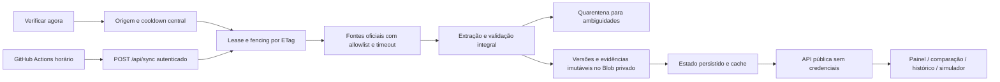

# Radar Frete ANTT

Monitor público dos pisos mínimos do transporte rodoviário de cargas. Mostra a tabela validada, compara coeficientes e mantém a origem de cada versão.

**Next.js · TypeScript · Vercel Blob privado · GitHub Actions**

[Acessar o sistema](https://radar-frete-antt.vercel.app) · [Fontes e regras](docs/fontes-e-metodologia.md) · [Operação e manutenção](docs/operacao.md) · [Skills](docs/skills.md)

[](https://github.com/igorcastro1010/radar-frete-antt/actions/workflows/ci.yml)
[](https://github.com/igorcastro1010/radar-frete-antt/actions/workflows/monitor.yml)

## Funcionalidades

- Painel da tabela vigente, publicação, vigência e situação da coleta.
- Quatro tabelas oficiais, filtros por carga/eixos/modalidade e exportação CSV.
- Comparação de CCD e CC, com diferença absoluta e percentual por item.
- Histórico normativo e registro de execuções, incluindo falhas parciais.
- Simulador habilitado apenas após conferir a versão atual com a calculadora oficial.
- Avisos de novas versões e identificação local de alterações não vistas; notificações com o site aberto e permissão do navegador.
- Coleta central, bloqueio distribuído por ETag, deduplicação e preservação da última versão válida.

Sem login, cadastro, administração pública ou edição manual de coeficientes. Os valores de produção são extraídos de atos oficiais; não há seed demonstrativo de produção.

## Cobertura e frequência reais

O histórico verificado começa em **17/07/2026**, pela Resolução ANTT nº 6.084/2026. A Portaria SUROC nº 22/2026 foi publicada em **29/09/2026** e entrou em vigor em **30/09/2026**. As duas versões contêm 272 combinações válidas cada.

O GitHub Actions está configurado para **uma consulta por hora, no minuto 17** (`17 * * * *`, UTC). Fortaleza é UTC−3, portanto o minuto permanece 17. A fila pode atrasar ou omitir execuções; não existe garantia de atualização instantânea. A descoberta também depende de o ato aparecer no índice oficial ou no ementário. A interface consulta apenas o armazenamento persistido, em intervalos de 60 segundos com a aba visível, com cache no servidor de até 5 minutos.

**Por que não 15 minutos?** A conta Vercel é Hobby: cron nativo apenas diário e Blob com 2.000 operações avançadas/mês. Duas escritas condicionais por coleta de 15 minutos consumiriam cerca de 5.952 operações em 31 dias, antes de evidências. A frequência horária usa cerca de 1.488 escritas de estado em 31 dias, com reserva para novas evidências. Cotas são compartilhadas na conta; excedê-las pode suspender o armazenamento. Nenhum serviço pago foi contratado.

“Verificar agora” compartilha o bloqueio e o orçamento da coleta, com intervalo global mínimo de 55 minutos. Uma primeira execução automática pode ocorrer após 10 minutos da carga inicial, para comprovar o agendamento. Uma solicitação manual próxima da janela automática pode fazer a agenda seguinte retornar cooldown; a latência pode aproximar-se de duas horas, além da fila e da publicação nas fontes.

Configuração de workflow não comprova execução agendada. O painel informa separadamente a última execução automática efetivamente registrada. Consulte o [relatório de implantação](docs/implantacao.md) para as evidências desta entrega.

## Fontes integradas

1. Índice de etapas da política no portal gov.br/ANTT: descoberta de atos.
2. Ementário do ANTTlegis: descoberta complementar.
3. ANTTlegis: íntegra dos atos e anexos, incluindo a Resolução nº 5.867/2020 consolidada para metodologia.
4. Calculadora oficial: formulário público para validar oito casos antes de habilitar uma nova versão no simulador.

O DOU tem link de referência, mas **a leitura automatizada direta do portal da Imprensa Nacional não está integrada**: os acessos de pesquisa retornaram 502 nesta implantação. Datas de publicação são extraídas da referência D.O.U. no próprio texto normativo do ANTTlegis. Notícias não servem como prova de coeficientes. [Detalhes e URLs](docs/fontes-e-metodologia.md).

## Executar localmente

Requer Node.js 24. As versões exatas das dependências estão fixadas no `package-lock.json`.

```powershell
npm ci
Copy-Item .env.example .env.local
npm run dev
```

Configure um Blob **privado exclusivo deste projeto**. Na Vercel, prefira `BLOB_STORE_ID` e OIDC com o store conectado ao projeto. Para desenvolvimento autenticado, `vercel env pull` fornece um token OIDC temporário; atualize-o quando expirar. Como alternativa, use token restrito ao próprio store em `BLOB_READ_WRITE_TOKEN`. Não reutilize segredos de outros sistemas.

As páginas funcionam sem conexão de armazenamento, apresentando estado indisponível, sem dados fictícios.

```powershell
npm run lint
npm run typecheck
npm test
npm run build
```

Para os testes completos no navegador, execute `npm run dev` em outro terminal e `npm run test:e2e`. Localmente usa Chrome instalado; em CI, instale o Chromium do Playwright. A suíte E2E depende de um armazenamento real já inicializado e não roda no CI público sem credenciais. O CI executa lint, tipos, testes unitários com fixtures oficiais e build sem segredos.

## Arquitetura



| Módulo | Responsabilidade |
| --- | --- |
| `src/lib/extract.ts` | Identidade dos atos, datas, cabeçalhos, schema de 272 combinações e hashes |
| `src/lib/collect.ts` | Descoberta e quarentena, controle de tempo total e evidências |
| `src/lib/sync.ts` | Concorrência, cooldown, promoção de versões e registros de execução |
| `src/lib/storage.ts` | Repositório Blob, arquivos imutáveis e escrita condicional |
| `src/lib/domain.ts` | Vigência em Fortaleza, comparação por item e CSV |
| `src/lib/calculation.ts` | Cálculo decimal e arredondamento validado |
| `src/lib/official-calculator.ts` | Verificação pelo formulário oficial, sem API inventada |
| `src/components/radar.tsx` | Interface pública e notificações locais |

Os registros completos de sincronização permanecem no estado persistido; a API pública exibe as 30 execuções mais recentes. Versões e evidências têm arquivos imutáveis independentes. A cópia das versões no estado facilita leitura; não existe rotina de alteração dos coeficientes históricos.

## Limitações concretas

- Não há push em segundo plano com navegador fechado.
- Descoberta não cobre toda a internet nem substitui pesquisa jurídica integral no DOU.
- Mudanças de metodologia, retificações e mudanças no conjunto de categorias/eixos são bloqueadas para revisão técnica e atualização do extrator.
- Não há alerta automático de fonte fora do site: failures ficam no painel e no workflow do GitHub.
- Simulador restrito a carga lotação a diesel e configurações listadas. Não calcula lucro, tributos, pedágio ou serviços complementares.
- O teste oficial cobre oito casos representativos (quatro tabelas, com/sem retorno), não todos os valores possíveis. Os coeficientes vêm integralmente do anexo.
- O preço e a disponibilidade das fontes podem mudar. A manutenção exige conferir novamente as regras oficiais antes de atualizar o schema ou a metodologia.

Os padrões de nomes, Next.js/TypeScript, documentação em português e workflow de verificações foram inspecionados nos repositórios públicos recentes do titular. Este repositório foi criado novo; os outros projetos não foram modificados.
